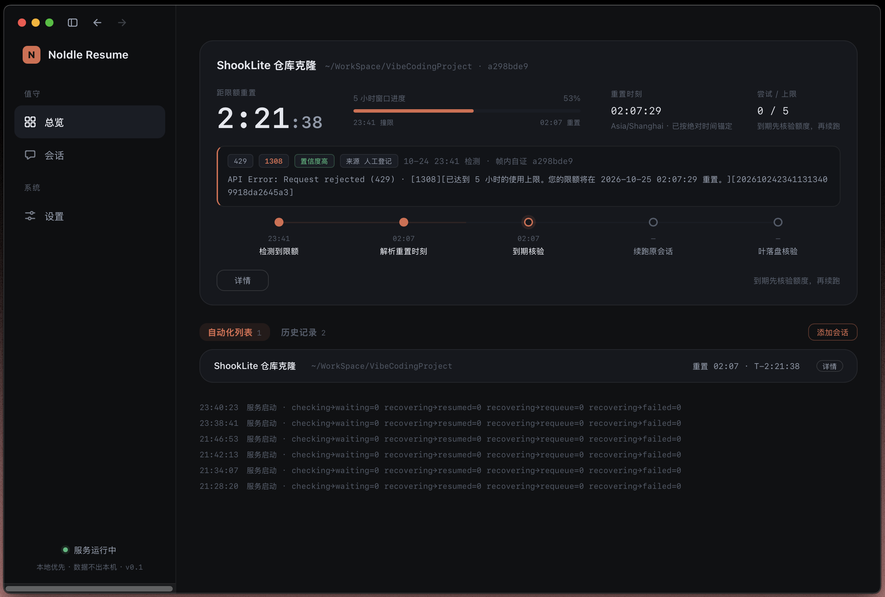
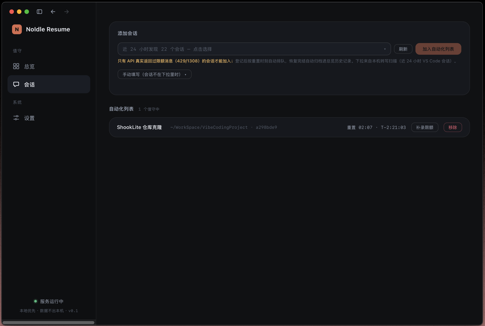
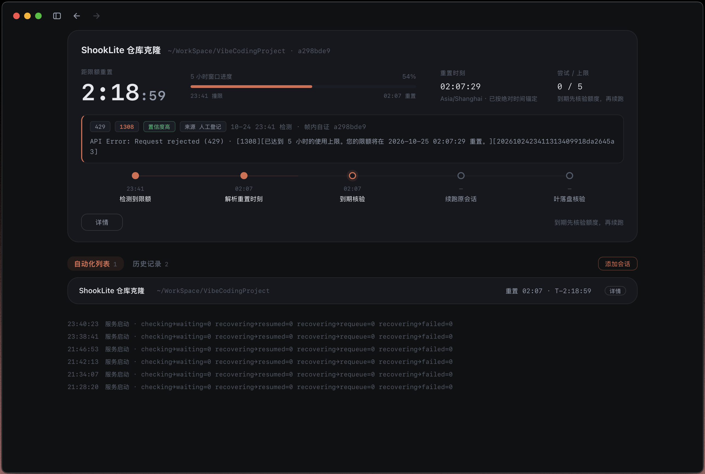
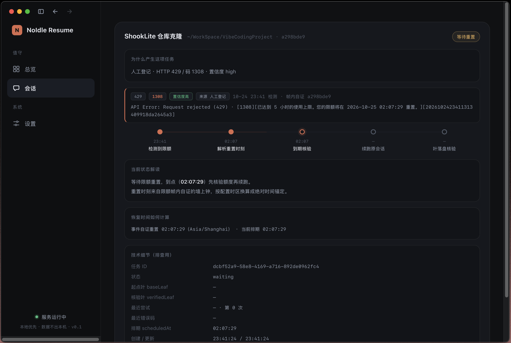
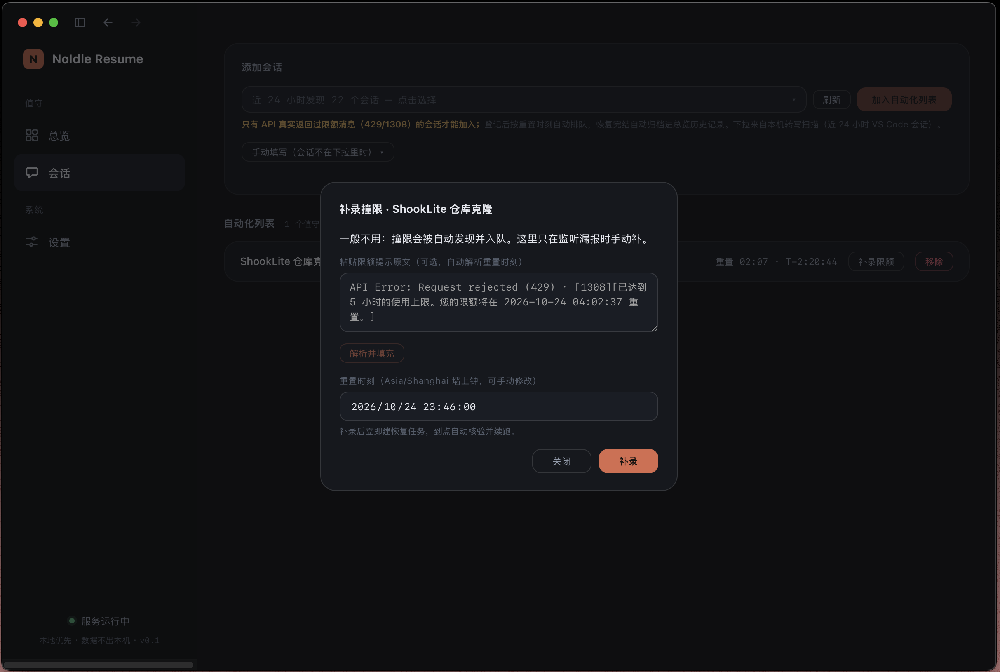
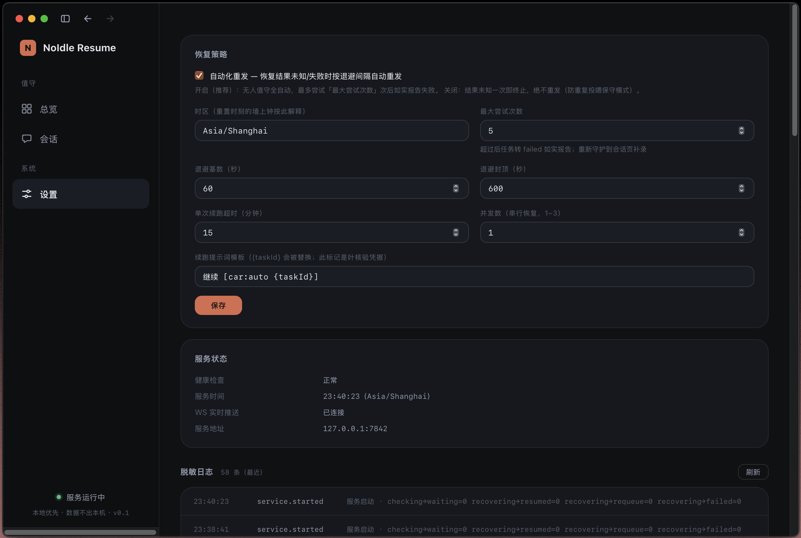

<div align="center">

# NoIdle Resume

**GLM Coding Plan 限额到点后，自动续跑 VS Code 侧边栏 Claude Code 会话的本地工具**

<em>本地值守 · 转写事实源 · 自动重发 · 零真额度测试</em>


[✨ 特性亮点](#-特性亮点) · [📸 界面预览](#-界面预览) · [🗺️ 路线图](#️-路线图) · [🚀 快速开始](#-快速开始) · [⚙️ 核心机制](#️-核心机制) · [🔒 安全与隐私](#-安全与隐私)

</div>

---

## ✨ 特性亮点

- 🔄 **自动续跑** — 限额 `api_error` 帧实时检测，重置时刻一到自动以 headless CLI 续跑会话，全程零人工
- 📡 **转写为事实源** — 结算只认转写落盘并过血统核验；续跑进程正常退出、超时、被杀甚至不退场，都不影响判定
- 🖥️ **值守台管理面** — Vue3 深色值守室：总览看板、会话页、任务详情六问、设置与日志四页；登记会话自动扫描转写根，免手抠 UUID
- 🔒 **本地与安全** — 只监听 `127.0.0.1`，令牌门 + HttpOnly Cookie；恢复引擎显式 `--permission-mode default`，绝不开危险模式
- 🧪 **零真额度验证** — 61/61 单元 + 集成测试、真浏览器 E2E 全链 13 步（假引擎演练），测试不烧一分钟额度
- 📦 **Mac 托盘壳** — Tauri v2 菜单栏常驻：单文件 sidecar、拉起/收割服务、开机自启、退出无孤儿进程

## 📸 界面预览

<table>
<tr>
<td width="50%" valign="top">

**总览看板**（[overview.png](assets/screenshots/overview.png)）



撞限任务实时状态：距重置倒计时、5 小时窗口进度、限额帧原文与置信度，自动化列表与历史记录同屏。

</td>
<td width="50%" valign="top">

**会话登记**（[sessions.png](assets/screenshots/sessions.png)）



登记下拉来自本机转写扫描（近 24 小时 VS Code 会话），选中即加入自动化列表，免手抠 UUID。

</td>
</tr>
<tr>
<td width="50%" valign="top">

**任务详情 · 实况**（[task-panorama.png](assets/screenshots/task-panorama.png)）



撞限事件全景卡：倒计时、窗口进度与五步事件链（检测 → 解析重置 → 到期核验 → 续跑原会话 → 叶落盘核验）。

</td>
<td width="50%" valign="top">

**任务详情 · 六问**（[task-detail.png](assets/screenshots/task-detail.png)）



为什么产生、状态怎么解读、恢复时间怎么算——技术细节给出任务 ID、起点叶 / 核验叶、排期与最近尝试。

</td>
</tr>
<tr>
<td width="50%" valign="top">

**补录限额**（[backfill.png](assets/screenshots/backfill.png)）



监听漏报时手动兜底：粘贴限额提示原文，自动解析重置时刻（按配置时区墙上钟），补录即建恢复任务。

</td>
<td width="50%" valign="top">

**设置**（[settings.png](assets/screenshots/settings.png)）



恢复策略（自动重发开关 / 尝试上限 / 退避参数 / 续跑超时 / 提示词模板）、时区与服务健康状态、脱敏日志。

</td>
</tr>
</table>

## 🗺️ 路线图

- ✅ **阶段一 · 技术验证** — 限额事件源、会话身份与转写定位、headless 续跑链路、冷热会话判据
- ✅ **阶段二 · 后台与任务引擎** — SQLite 持久化（WAL + 迁移）、限额解析、任务状态机、串行调度、本地 API + WebSocket
- 🚧 **阶段三 · 管理面与桌面壳（当前）** — Web 四页值守台、会话自动发现与登记、转写硬结算、Mac 托盘壳
- ⬜ **阶段四 · 安全加固与发布** — 兼容性扩展、打包分发

## 🚀 快速开始

环境要求：Node.js ≥ 22.13。

```bash
npm install
npm run build      # 构建前端到 apps/web/dist
npm start          # 启动本地服务（默认 127.0.0.1:7842，直接托管管理页）
npm test           # 单元 + 集成测试（零真模型调用）
npm run smoke      # 冒烟：起真服务走 API 全链（假恢复引擎）
npm run dev        # 仅后端开发态
npm run dev:web    # 前端开发态（vite :5173，代理 /api 到 7842）
node scripts/e2e-web.mjs   # Web 管理面真浏览器 E2E（需系统 Chrome，零真额度）
npm run typecheck
```

启动后控制台打印本机访问令牌（同时写入数据目录 `token.txt`，权限 0600）。浏览器打开 `http://127.0.0.1:7842`，粘贴令牌进入值守台。

环境变量：`CAR_DATA_DIR`（数据目录）、`CAR_PROJECTS_ROOT`（转写根，默认 `~/.claude/projects`）、`CAR_CLAUDE_BIN`、`CAR_HOST`、`CAR_PORT`。

演练模式：把 `CAR_PROJECTS_ROOT` 指向真实转写根并配假引擎时，给假引擎加 `CAR_FAKE_NOWRITE=1`（`scripts/fake-claude.mjs` 只输出成功结果、绝不向转写落帧，血统核验会诚实失败）。注意 `@fastify/static` 在启动时挂静态路由——**重建 dist 后需重启进程**。

## 🍃 Mac 应用（Tauri 托盘壳）

无原生模块的本地服务编译为单文件 sidecar（bun），Tauri v2 壳负责菜单栏常驻、拉起/收割服务、开机自启：

```bash
brew install rust bun                 # 构建工具链
npm install
npm run build                         # 前端 dist（sidecar 与 .app 共用）
node scripts/gen-icon.mjs             # 生成图标源图（品牌橙底黑 N）
cd apps/desktop && npx tauri build    # 产出 .app + .dmg
```

产物：`apps/desktop/src-tauri/target/release/bundle/{macos,dmg}/`。
托盘菜单：打开管理页 / 复制访问令牌 / 登录时启动 / 退出；纯菜单栏应用（不占 Dock）。
数据目录与服务端一致（`~/Library/Application Support/noidle-resume`）；sidecar 随壳退出被收割，无孤儿进程。

注意：使用 .app 时请关闭开发态服务（`npm run dev`），避免两个调度器共用同一数据库。

## ⚙️ 核心机制

| 机制 | 实现位置 |
| --- | --- |
| 限额事件源 = 转写 `api_error` 帧 | `modules/limit/detector.ts` + `modules/watcher/` |
| 头部读窗 = 行数优先 + 字节兜底 | `adapters/vscode-claude/transcriptLocator.ts` |
| 登记下拉 = 只读扫描转写根最近会话（`entrypoint=claude-vscode` 才收，不入库） | `modules/discover/discoveryService.ts` |
| 重置时刻按配置时区解析 | `modules/limit/timezone.ts` |
| 冷会话守卫 `pgrep --resume=<sid>` | `modules/resume/coldGuard.ts` |
| headless 续跑引擎 | `modules/resume/runner.ts` |
| 叶血统核验，禁文件级启发 | `modules/resume/transcript.ts` |
| 串行调度 + 指数退避 | `modules/scheduler/` |
| 崩溃对账单位=叶，结果不明即 paused | `scheduler.reconcileOnBoot()` |
| 同会话单活动任务 | 部分唯一索引 `idx_tasks_active` |
| 倒计时只在展示层动态计算 | `apps/web/src/stores/ticker.ts` |
| 任务详情回答六问 | `apps/web/src/pages/TaskDetailPage.vue` |

## 🔒 安全与隐私

安全设计：

- 只监听 `127.0.0.1`；令牌鉴权；写操作 CSRF 防护（自定义头 + Origin/Host 校验）
- 恢复引擎显式 `--permission-mode default`，**绝不使用** `--dangerously-skip-permissions`
- 未登记会话的事件一概不落库；日志脱敏截断
- 会话由工具续跑后即「已接管」，展示以工具自有面为准，侧边栏视为只读发源地

隐私边界：

- 全部数据（任务、日志、访问令牌）只存本机数据目录，**无任何遥测与上报**
- 对外仅访问本机转写目录与你所配置的模型 CLI，不经过任何第三方服务器
- 令牌文件 `token.txt` 权限 0600，仅本机当前用户可读

## 📁 目录

```
apps/server/          本地服务（Fastify + SQLite + 任务引擎）
apps/web/             Vue3 管理面（Vite 构建，服务端托管 dist）
apps/desktop/         Mac 托盘壳（Tauri v2 + bun sidecar）
packages/contracts/   前后端共享类型与错误码
migrations/           SQLite 迁移
tests/                单元 + 集成测试（fake-claude 假引擎）
scripts/              fake-claude.mjs（测试假引擎）、smoke.mjs（冒烟）、e2e-web.mjs（Web E2E）
```

## 📄 声明

- 本项目以 [Apache License 2.0](LICENSE) 开源
- 本项目为独立的本地效率工具，与 Anthropic（Claude）及 GLM 服务提供方**无隶属关系**，亦非其官方客户端
- 限额策略与重置规则以服务商实际策略为准，本项目仅按转写中的事件做本地自动化
- 软件按「现状」提供，使用前请自行评估；请遵守你所使用模型服务的用户条款

---

<div align="center">

**NoIdle · Keep Building 持续构建**

<sub>© 2026 NoIdle</sub>

</div>
